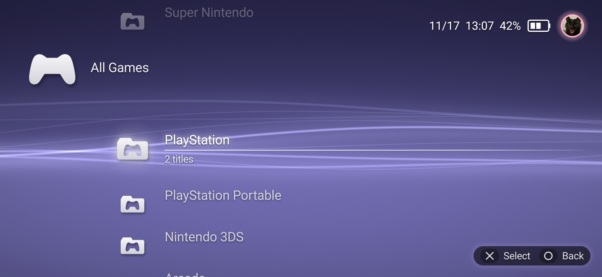
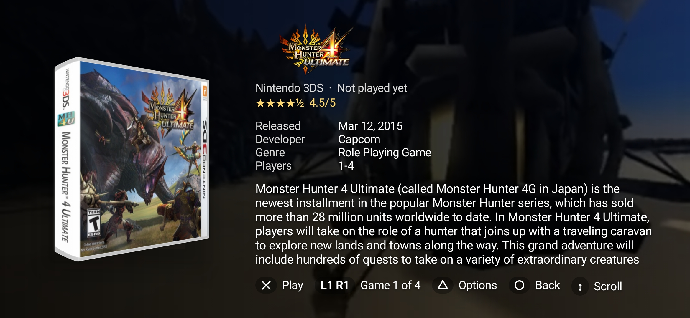
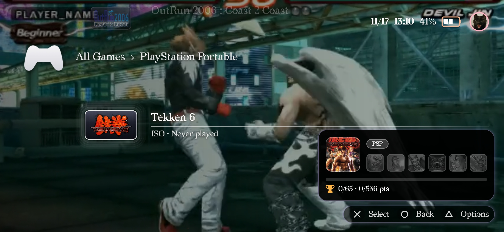
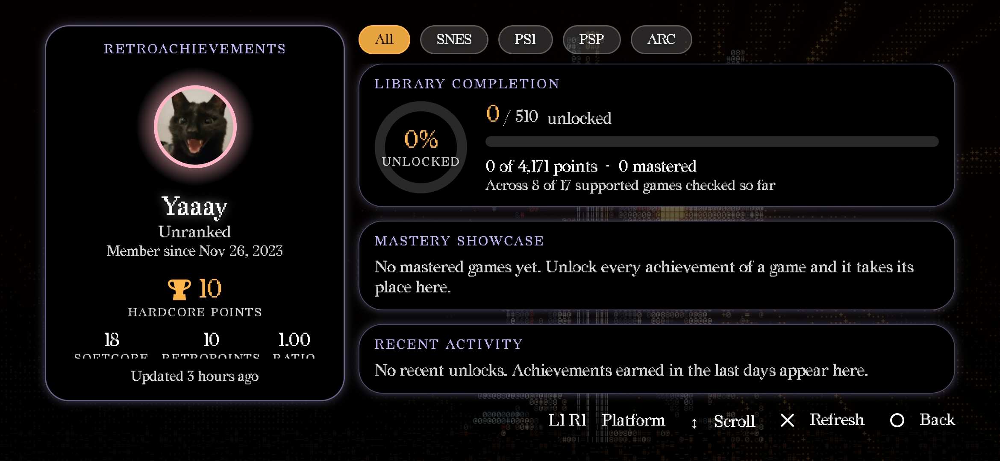
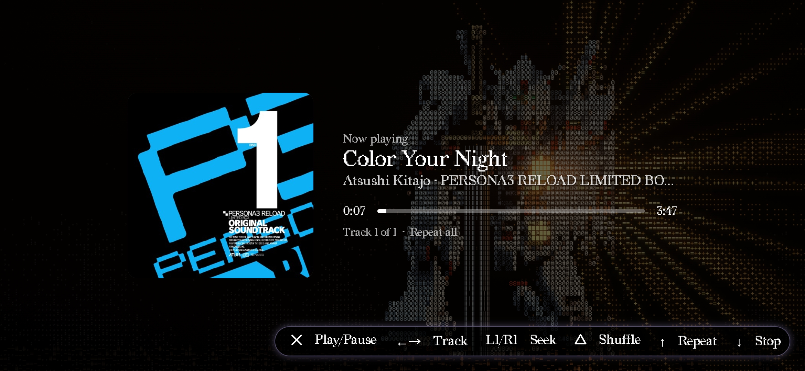
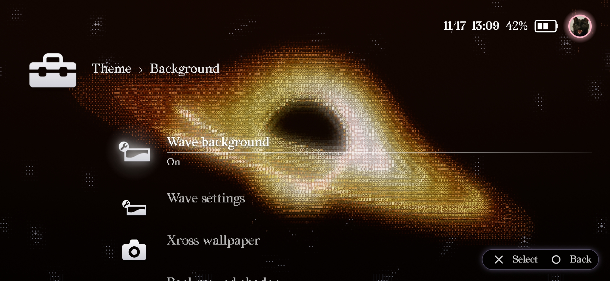
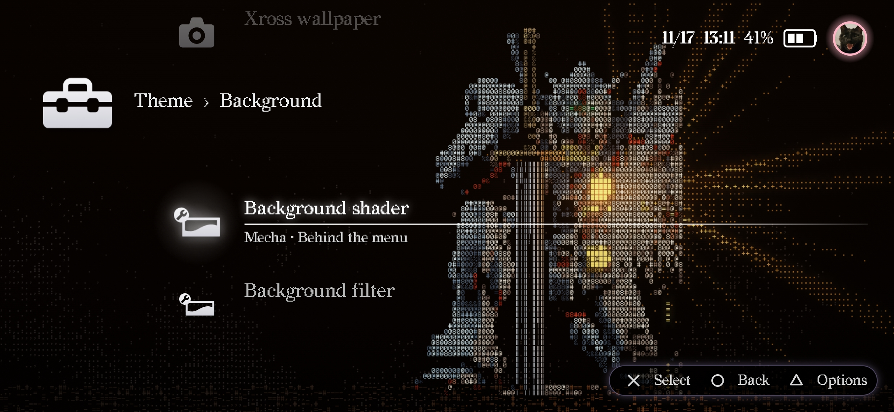
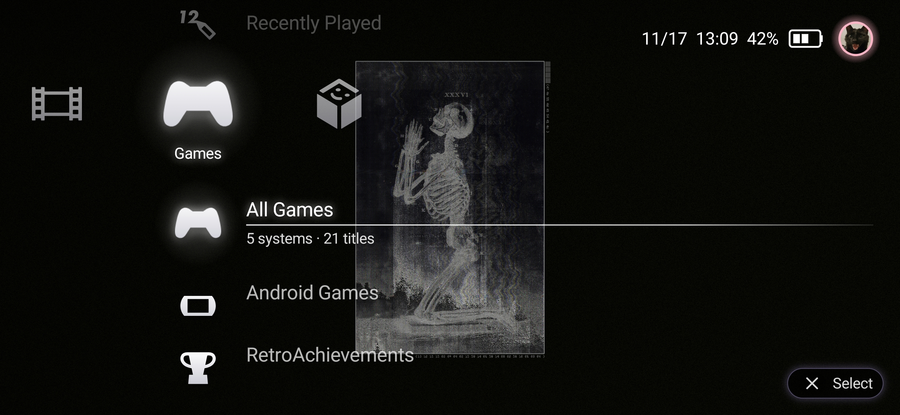

<div align="center">

# Xross

**A controller-first cross-media bar launcher for Android handhelds and TVs.**


**[⬇ Download the latest release](https://github.com/luyisiludong-svg/Xross/releases)**

</div>

**A 100% FOSS, XMB-style launcher for Android handhelds and TVs — no paywalls, no closed binaries, no telemetry.**


> **Status: 0.2.3.0-beta.** The library, scraping, RetroAchievements and
> the full Theme 2.0 engine are in. Expect rough edges: so far it has been tested on the Android
> emulator and on a Samsung Galaxy A55, but not yet on a gaming handheld or with a physical
> controller. See [`CHANGELOG.md`](CHANGELOG.md) for what changed, [`Roadmap.md`](Roadmap.md) for
> what is next and [`docs/STATUS.md`](docs/STATUS.md) for what has been verified, and on which
> hardware.

## Screenshots

### The menu

Categories run across, items run down, over the animated wave background. The status bar shows the date, time, battery and your RetroAchievements avatar.



### Game details

Box art, rating, release info and a description for each game, scraped automatically. L1 and R1 step through the other games in the list.



### Game list with achievement card

The selected game's video snap plays behind the list, and a card shows its RetroAchievements badges and progress.



### RetroAchievements profile

Your points, library completion, mastered games and recent unlocks, filterable by platform.



### Music player

Now playing with album art, seek bar, shuffle and repeat, all on the controller.



### Black hole shader

The bundled Gargantua theme renders an animated ASCII black hole behind the menu.



### Mecha shader

Background shaders can be swapped from Theme › Background.



### Your own wallpaper

Set any image as the Xross wallpaper and choose how it fits: fill, fit, stretch or center.



[`docs/XMB_FIDELITY.md`](docs/XMB_FIDELITY.md) compares Xross with the original menu screen by
screen.

## Features at a glance

### 🎮 Navigation and gamepad

- Real D-pad ergonomics: per-category drill-down stacks, breadcrumbs, spring-animated scrolling,
  plus touch swipe, tap and long-press.
- Controller vendor detection (Sony, Microsoft, Nintendo, generic) with matching button glyphs and
  a confirm/cancel swap.
- Radial and axial deadzones, anti-snapback, and stick/hat auto-repeat.
- A button-remap wizard saved per controller model, an Options (△ / Y) menu on every row, and media
  controls on Select.

### 📚 Library and metadata

- 23 platforms detected from folder names, scanned across internal storage, microSD and USB-OTG,
  with an FTS4 search you can type with a gamepad.
- Hash fingerprinting inside `.zip`, `.7z` and CHD files, including No-Intro header-less hashes.
- Offline DAT verification against No-Intro, Redump and MAME.
- Artwork, descriptions and video snaps from Hasheous, SteamGridDB and ScreenScraper, cached
  ES-DE style. ScreenScraper works out of the box on a shared quota.
- **Settings ▸ Accounts** in one place: link RetroAchievements, and sign in to your own
  ScreenScraper account for your own daily quota (the login is checked as you save it).
- RetroAchievements: a status-bar avatar with a mini-HUD, a User Card, a dashboard, per-game badge
  grids and unlock toasts.
- One-press launch into RetroArch, DuckStation, NetherSX2, Dolphin, PPSSPP and eight more emulators,
  chosen per system or per game. Add any other emulator or system on the device (Settings ▸
  Emulators ▸ Add emulator… / Add system…) or in `emulators.json`, in ES-DE's launch syntax.
- Fix a game's art and description in the Metadata & Media editor, choosing from every
  ScreenScraper and SteamGridDB image, and go through a whole system with **Fix media…**.

### 🎨 Theme 2.0 engine

- Six built-in packs: **XMB** (the default), the classic cross-media bar look; **Xross**, with
  Phosphor icons; **Gargantua**, an ASCII black hole; and the showcase packs **MEMENTO//MORI**,
  **UNIT//TERMINAL** and **BREAKCORE.ERR**, each with its own shader, surfaces, rules and variants.
- Two menu styles: the cross media bar, or **SLASH**, a bold slanted list skinned with the theme's
  own art, with stacked or plated clocks and slanted hint tags.
- Theme packs in plain JSON (palettes, font roles, surfaces, icons, sounds) that hot-reload while
  you edit them, or install from one `.xtheme` file.
- A Live Theme Mixer for layout, scale and spacing, and export of your look as a pack or a
  shareable `.xtheme`.
- Background shaders (Wave, MECHA, Black Hole, Starfield, Bokeh, ASCII Matrix), your own
  `shader.frag`, and audio-reactive uniforms driven by Xross's music player. A
  [browser preview](tools/shader-preview/index.html) shows a shader or pack on the desktop.
- Frosted-glass surfaces, wallpapers (one picture, or a folder or Photo album taking turns), focus
  frames, app icon masks and ambient particles.
- Theme music from the pack, or your own: a file, a folder or a Music playlist, crossfading and
  shuffled or in order.
- Scanline, CRT and LCD-grid filters in GL, and AGSL UI filters on Android 13+.
- Context rules (category, system, battery, time of day), a circadian color curve, palettes taken
  from game art, and quick profiles: OLED True Black, Y2K Cyber-Pastel and Monochrome E-Ink.
- Built to stay smooth: effects rest when you stop pressing buttons, and frame pacing is measured
  on 60 Hz and 120 Hz panels.

### 💾 Portable by design

- One `Xross/` folder holds your config, DATs, art, ROMs and themes. Move it to an SD card or USB
  drive and take it to another device.
- Drives can be hot-swapped without losing their games from the library.
- The library database is backed up to the folder automatically and can be restored on a fresh
  install. Account credentials never leave app-private storage.

## Quick start

**You need** an Android 9+ device (API 28) with a landscape screen.

**Install:** download `Xross-<version>.apk` from the
[releases page](https://github.com/luyisiludong-svg/Xross/releases) and open it on the device
(allow installs from your browser or file manager when asked). The whole launcher is under 9 MB;
artwork and video snaps download later into the `Xross/` folder.

Then on the device:

1. **Grant storage access:** Settings ▸ Library ▸ All files access.
2. **Add games:** put ROMs in platform folders under `Xross/roms/` (`snes/`, `psx/`, `gba/`, …).
   Settings ▸ Library ▸ Base ROMs folder ▸ Create system folders makes them all for you.
3. **Optional:** drop DATs in `Xross/dats/` and import them, turn on scraping in Settings ▸
   Library ▸ Metadata & artwork, link your accounts in Settings ▸ Accounts, or copy a theme pack
   into `Xross/themes/`. Keep your own BIOS files in `Xross/bios/` and point your emulators there.

### Building from source

You need the Android SDK and JDK 17.

```bash
./gradlew :app:testDebugUnitTest     # fast JVM unit tests
./gradlew :app:installDebug          # build and install on a device or emulator
```

ScreenScraper needs developer credentials, read at build time from a git-ignored `.env` (see
[`.env.example`](.env.example)). Without them a build still runs, with ScreenScraper turned off; a
release build refuses to run without them. Details are in the
[developer guide](docs/DEVELOPMENT.md).

Upgrading from **Wave**? The project was renamed on 2026-11-11 and the app ID changed to
`dev.xross.launcher`, so uninstall the old app by hand
([details](docs/USER_GUIDE.md#1-before-you-start)).

## Documentation

| Guide | What's in it |
| --- | --- |
| [User and storage guide](docs/USER_GUIDE.md) | The `Xross/` folder, SD/USB, backups, ROM folders, DATs, scraping, RetroAchievements, media and apps, feature status |
| [Changelog](CHANGELOG.md) | What changed in each release |
| [Theme 2.0 specification](docs/THEME_SPECIFICATION.md) | Pack layout, `theme.json` v2, surfaces, sounds, Wave settings, effects, rules, quick profiles, `.xtheme` |
| [Shader guide](docs/SHADER_GUIDE.md) | Writing background shaders, their uniforms, and previewing them in the browser |
| [Shader tutorial](docs/SHADER_TUTORIAL.md) | Making your own shaders, starting from a template |
| [Developer guide](docs/DEVELOPMENT.md) | Building, unit/live/device tests, emulator stand-ins, source layout |
| [Roadmap and backlog](Roadmap.md) | The plan: what is done, known issues, order of work, scope decisions and upcoming specs |
| [Implementation status](docs/STATUS.md) | The status dashboard, with per-phase evidence under `docs/phase-*/` and `docs/status/` (test suites, device runs, frame timings, bugs found and fixed) |
| [Docs index](docs/README.md) | Every document under `docs/` and how the folder is laid out |
| [Hardware testing checklist](docs/HARDWARE_TESTING.md) | Testing on a physical handheld, and what to send back |
| [Architecture assessment](docs/design/ARCHITECTURE_ASSESSMENT.md) | Structure, tech debt and a prioritized refactoring plan |
| [XMB fidelity analysis](docs/XMB_FIDELITY.md) | How close Xross is to the original menu, checked against the console manuals |
| [ScreenScraper API guide](docs/reference/SCREENSCRAPER_API.md) | English summary of ScreenScraper's API rules |
| [Ricing and Web Studio proposal](docs/design/THEME_RICING_AND_WEB_STUDIO.md) | Plain-text themes, a browser theme studio and a desktop build (proposal) |
| [Feasibility review](docs/design/FEASIBILITY.md) | The review behind the original scope changes |
| [Product scope](project_scope.md) | The original product scope |

## Testing

Xross is tested on three levels:

- **Unit tests** (over 990: JVM and Robolectric in `:app`, plain JUnit in `:theme:engine`):
  `./gradlew :app:testDebugUnitTest :theme:engine:test`. Opt-in live tests call the real scraping
  and RetroAchievements APIs with credentials from `.env`.
- **Device tests** over adb, in three tiers: `smoke.sh` (12 checks, ~30 s), five focused suites
  (library, theme, media, input, integration), and `run-all.sh` for the full regression of more
  than 540 checks.
- **Frame timing** on the R8-optimized `profiling` build (`palette-perf.sh`, `display-matrix.sh`).

> ⚠️ **Run device tests on a throwaway emulator or test device only.** They wipe Xross's data and
> delete `/sdcard/ROMs` to seed their own fixtures.

Commands and details are in the [developer guide](docs/DEVELOPMENT.md#testing) and
[`HARDWARE_TESTING.md`](docs/HARDWARE_TESTING.md).

## License, credits and community

Xross is released under the [Apache License 2.0](LICENSE). The icons, fonts, shaders, libraries
and services it builds on are credited in [`CREDITS.md`](CREDITS.md).

Bug reports and ideas are welcome as [issues](https://github.com/luyisiludong-svg/Xross/issues);
check [`Roadmap.md`](Roadmap.md) first to see whether something is already planned.

Xross is an independent fan project. It isn't affiliated with or endorsed by Sony Interactive
Entertainment.
